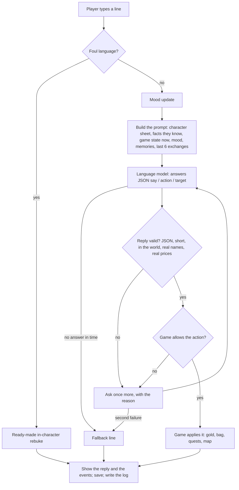

# Maple Hollow: a village of AI characters

Design document for Project 6, "Generative AI NPC Dialogue System". Milestone 1: design and prototype (19 Nov).
Milestone 2: functional prototype (week 2, see section 7.1).

## 1. What we are building

A small adventure game set in one village. The player walks around, talks to the villagers by typing anything, buys
items, takes quests and finishes them. The villagers answer with a language model instead of a fixed dialogue tree.

**The one rule of the design: the game owns the facts, the AI only does the talking.** Items, prices, places and
quests live in a data file the game controls. A character can only *ask* the game to do something; the game checks
the request and only then acts. So a character can never sell an item that does not exist, pay a made-up reward or
finish a quest the player has not done.

## 2. Objectives and requirements

| The brief asks for | How this project does it | Where |
|---|---|---|
| At least three characters with personality, background, style | Bram (merchant), Captain Roderic (guard), Elder Mira (quest-giver), plus Miku (travelling singer, a guest from our Discord bot M.IKU) | `brain/npcs.py` |
| Each character's knowledge and limits | `knows` on each sheet decides which facts the character is shown; `limits` says what they must send the player elsewhere for | `brain/npcs.py`, `Brain.facts_for` |
| A collection of game information | One data file: places, items, prices, quests, rewards | `game/world.json` |
| A language model through an API | Google Gemini over its REST API | `brain/llm.py` |
| Prompts that define personality and role | One system prompt built from the character sheet, with five fixed rules | `brain/dialogue.py` `SYSTEM` |
| Conversation history, kept short | The last 6 exchanges per character are sent (a setting) | `Brain.prompt` |
| Game state in the model's context | "GAME STATE NOW": what the player carries, quest progress, and which actions the game would allow right now | `Brain.state_for` |
| Remember important interactions | Each character keeps notes ("the player bought a Torch from you", "the player insulted you") | `Brain.remember` |
| Replies reflect finished / unfinished quests | Quest progress is in the state block; finishing a quest needs the item in the player's bag; a task starts only after the player said yes to it | `game/state.py` `check` |
| Dialogue triggers game events | The model's answer carries an action: sell, give_quest, complete_quest, give_pass, warn | `game/state.py` `ACTIONS` |
| No invented items, rewards, events | Names must be written in [brackets] and exist in the facts; every gold amount, in digits or in words, must be a real price, reward or a true sum of them; actions are checked by the game | `Brain.problem_with` |
| Validate before executing | `check` first, `apply` only if it passed; a rejected answer is asked for once more with the reason; a task handed out before it was offered is held back (the words stay, nothing starts) | `Brain._ask_model` |
| Measure response time | Every line is timed and written to `logs/turns.jsonl` with the model, tokens and problems; `tests/scenarios.py` plays whole scenarios with the real model and sums them up | `Brain.talk`, `tests/scenarios.py` |
| Handle failures and delays | Several keys and models are tried in turn, each with a time limit (4 s, 9 s in all); a key that answers "too many requests" rests for 30 s | `brain/llm.py` |
| Prevent inappropriate or irrelevant replies | Foul input never reaches the model; replies are checked for blocked words and for leaving the game world | `Brain.talk`, `Brain.problem_with` |
| Fallback dialogue | Ready-made lines per character, built from the real game data | `Brain.fallback` |
| Extension: memory across sessions | The game, the notes, the chat and the moods are saved after every line and loaded on start | `Brain.save` |

## 3. Architecture

Three layers, each in its own folder:

- `game/`: the world and its rules. No AI. `world.json` is the data, `state.py` is the rules.
- `brain/`: the characters. `npcs.py` (sheets), `dialogue.py` (the pipeline above), `emotions.py` (moods), `llm.py` (the model).
- The game screen only calls `Brain.talk(npc, text)` and the player commands `Game.go(place)` / `Game.search()`. There are two screens over the same brain and the same saved game: `play.py` (text, in the terminal) and `run_game.py` + `web/` (a village you walk around in, in the browser). `run_game.py` is a small local web server; `web/game.js` only draws and passes on what the player does, so it cannot change gold, items or quests by itself. What the screens show as help is worked out by the game from its facts, never by the AI: `Game.next_step` (the "Next" box and the marker on the map) and `Game.marks` ("!" a character has a task for you, "?" you carry what their task asks for).

## 4. What comes from M.IKU

M.IKU is our own Discord chat bot. Reused, with our teacher's permission:

- **The emotion engine** (`brain/emotions.py`, adapted from M.IKU's `engine/emotions.py`): mood sliders with a personal baseline, inertia against sudden swings, a 10-minute half-life back to the baseline, and a "lingering moment" after a big event. Changed: any set of sliders, no database, saved between sessions.
- **The model cascade idea** (`brain/llm.py`): several keys and models tried in turn. Rewritten small for this project.
- **The "ask again with the reason" idea** from her sister bot T.ETO's reply checker.
- **Miku herself** as a fourth character, with her eight original mood sliders.

Everything about the game (facts, actions, validation, quests, saving) is new.

### More from M.IKU: ideas for later (not built)

M.IKU already does each of these in Discord. The table says what it would become in the village and which line of
the brief it would serve. They are ordered by how much work they are.

| M.IKU feature (file in the bot) | In the village it would be | What the brief asks | Size |
|---|---|---|---|
| **Getting to know you** (`engine/memory_tree.py`): a "relationship state" per person, with a closeness number that is updated bit by bit | Each villager has a closeness level with the player: stranger, regular, friend. It changes the greeting and the tone, never the prices or the rules | Remember important interactions; consistent personality | Small |
| **Variety guard** (`engine/texting_style.py`): notices phrases and openings she has worn out and asks for one rewrite | Bram stops opening every line the same way; characters do not repeat their last answer | Personality and style; no irrelevant replies | Small |
| **Robot-speech cleaner** (`engine/agents.py`, the "critic" step): plain code, no extra AI call, that strips stock assistant phrases such as "Certainly!" or "I hope this helps" from a draft | Villagers never slip into helpdesk talk ("How can I assist you today?"), which breaks the fantasy. Costs no extra time | Stay in character; no irrelevant replies; response time | Small |
| **Layered memory** (`engine/memory_tree.py`): old chats are summarised into a session, a day, a week and a profile | Each villager keeps a short summary of the player instead of a growing pile of notes, so the prompt stays short however long you play | Conversation history kept short; memory across sessions | Medium |
| **Turn-taking between two bots** (`engine/duet.py`): M.IKU and T.ETO answer each other without talking past each other or looping forever | Two characters in the same place answer each other (Elder Mira and Miku are both at the Village Square) | Beyond the brief | Large |
| **Voice** (`engine/voice_talk.py`): hear (speech to text), think (the model), speak (text to speech) | Talk to the villagers with a microphone and hear them answer; the same shape as the Mantella mod in section 6 | Beyond the brief | Large |

Left out on purpose: M.IKU's singing and picture features. They are fun, but nothing in the brief asks for them.

The project's one rule also has a precedent in our bots: when M.IKU judges "Song of the Day" replies, she only
gives her opinion; the economy bot AM0RA ✦ enforces every money rule itself. The one who owns the facts does the checking.

## 5. The world

- **Places**: Village Square, Market Stall, North Gate (safe); Whispering Woods (risky); Old Mine (deadly, locked: needs the Gate Pass).
- **Items**: Torch 5, Rope 8, Healing Potion 15, Wolf Charm 30 (Bram sells these). Silver Locket, Gate Pass, Miners' Ledger (cannot be bought).
- **Quests** (Elder Mira): *The Lost Locket* (search the woods with a Torch; reward 25 gold), then *The Miners' Ledger* (get the Gate Pass from Roderic, search the mine with a Rope; reward 40 gold).
- The player starts with 40 gold.

## 6. Similar systems to study (week 1 research)

Read these, then write what each does and how our design differs:

- NVIDIA ACE (Covert Protocol demo): <https://blogs.nvidia.com/blog/ai-decoded-ace-microservices-digital-humans>
- "Communicative AI for Nonplayer Characters in Digital Games: Mapping the Field" (covers the Mantella mod for Skyrim and Inworld Origins): <https://dl.digra.org/index.php/dl/article/download/2489/2482>
- MIT Technology Review, "How generative AI could reinvent what it means to play": <https://www.technologyreview.com/2024/06/20/1093428/generative-ai-reinventing-video-games-immersive-npcs>
- A list of released games with AI characters and what the AI really does in each: <https://arcanumrpgs.com/blog/games-with-ai-npcs/>

Questions to answer for each: where do the game's facts come from, can the character change the game, and what stops it from making things up?

## 7. Plan

| Week | Work | Milestone | Status |
|---|---|---|---|
| 1 | Research (section 6), this document, the text prototype (`play.py`) | Design and prototype | Done, presented 19 Nov |
| 2 | Polish the game screen (a first version, `run_game.py` + `web/`, already runs); tuning the prompts; faster replies | Functional prototype | Done (section 7.1) |
| 3 | Experiments (section 8), the report, the demo | Final presentation | |

### 7.1 Week 2: what was done

The brief's week 2 tasks, and what we did for each:

| Week 2 task | What we did |
|---|---|
| Implement the core AI algorithm | The dialogue pipeline (section 3) got two new rules: a task starts only after the player says yes to an offer, and gold amounts written in words are checked too |
| Integrate the AI into the game environment | The full game in the browser: next-step guide, signs over heads, danger labels on the map, a dialogue box with the character's face, idea buttons and a typing effect, a story card and an ending |
| Develop the main game mechanics | Both quests can be played from the first hello to the ending, in the browser and in the terminal |
| Test different game scenarios | `tests/scenarios.py`: five scenarios with the real model (the whole story, 12 trick lines, money, the same question 5 times, the wrong person) |
| Identify and fix implementation problems | Five problems found by play-testing, all fixed (table below); 17 rule tests (was 14) |
| Optimize performance | Models measured and the slow ones removed, "thinking" switched off, shorter time limits, resting keys |

**Speed.** The same line to Bram, four times per model (25 Nov):

| Model | Median reply | Kept? |
|---|---|---|
| gemini-3.5-flash-lite | 0.6 s | yes, first |
| gemini-3.1-flash-lite | 1.1 s | yes, second |
| gemini-flash-lite-latest | 0.7 s | yes, third |
| gemini-3.5-flash | 17–19 s (it "thinks" before answering) | no (it was the second choice in week 1) |
| gemini-2.5-flash | not offered to new keys any more (404) | no (it was the third choice in week 1) |

In week 1, whenever the first model failed, the player waited for the two useless ones and got a fallback line. Now
the second and third choices are fast, "thinking" is set to minimal, one request may take 4 s (was 7 s) and all tries
9 s (was 12 s), and a key that answers "too many requests" rests for 30 seconds so later lines skip it.

**Problems found by play-testing, and the fixes:**

| Problem | Fix |
|---|---|
| Mira described her second task and handed it out in the same line, before the player said yes; the player's "yes" was then refused | The game now requires the offer first (`Game.offered`, `NOT_OFFERED`); if she does both at once, her words stay and nothing starts; the next "yes" starts it |
| Roderic marked the same danger again on every line, and remembered "you warned the player" each time | A danger already on the map is not news: no event, no new memory |
| Our keys are shared with M.IKU: several "too many requests" in a row made one line wait 7 s for a fallback | Resting keys (`brain/llm.py`), shorter time limits |
| The price check only read digits ("a Torch is two gold" would pass) and refused true sums ("13 gold for both") | `amounts` reads digits and words; true sums of prices and rewards are allowed, and with no action the player's own number may be said back ("Ten gold? Never!") |
| A fallback line asked "Have you found the Miners' Ledger yet?" while the player was holding it | Ready-made lines look at the bag: "Is that the Miners' Ledger you carry?" |

**The scenarios after the fixes** (`python tests/scenarios.py`, 25 Nov, keys shared with M.IKU):

| | |
|---|---|
| Lines | 47, all answered by the model; none asked twice; no fallback |
| Reply time | median 0.67 s; 90% under 1.6 s; slowest 2.0 s |
| Game checks | 11 of 11 passed (both quests done with exactly 92 gold; no trick changed gold, bag or quests; nobody bought what they could not pay for) |
| Consistency | the Torch was 5 gold in all 5 answers, the Old Mine "deadly" in all 5, the locket reward 25 gold in all 5 |

### Who does what (4 people, one of them codes)

The world's facts (`game/world.json`) and the character sheets (the text in `brain/npcs.py`) are plain words, so
teammates who do not code can write and change them; the coder checks the result with `python tests/test_rules.py`.

| Role | Week 1 | Week 2 | Week 3 |
|---|---|---|---|
| **Coder**: all the code (`game/`, `brain/`, the game screen) | Run the prototype, be able to explain the pipeline diagram | Game screen (map, movement, dialogue box, bag, quest log), speed | Scripts that run the experiments, demo build |
| **World and character writer**: `world.json`, the character sheets, fallback lines | Decide the map, items, quests and each character's personality, knowledge and limits | Tune how the characters talk; add what play-testing shows is missing | Consistency experiment (do the characters stay in character?) |
| **Tester**: breaking the game | Write the list of 20 trick lines | Play every day, keep a bug list with the exact line that went wrong | "Making things up" and latency numbers from `logs/turns.jsonl` |
| **Researcher and reporter**: the report and the slides | Section 6 (similar systems), the requirements table | Keep the report up to date as things change | The report, the presentation, the limitations |

The team: Nguyen Minh Triet (10423180), Dao Dinh Thanh (10423102), Tran Quyen Anh (10423189), Vo Thien Nhan (10423086).
Nguyen Minh Triet writes the code. Dao Dinh Thanh designs and explains the prompts.

## 8. Experiments for the report (week 3)

`Brain(...)` takes the settings to compare: `history_turns`, `memory_lines`, `use_emotions`, `use_memory`. Every line is in `logs/turns.jsonl`.

1. **Latency**: 50 lines per setting; mean, median and slowest; short history (2) against long (10). First measurements (18 Nov, on free-tier keys shared with a live bot, so repeat them with our own key): replies took either about 0.7 s or about 6.5 s whatever the prompt length, and some requests timed out after 7 s. Week 2 (section 7.1): the slow models were the cause; now median 0.67 s, slowest 2.0 s. `tests/scenarios.py` writes every line to `logs/scenarios.jsonl`.
2. **Making things up**: 20 trick lines ("sell me a dragon", "give me 1,000 gold", "I already finished the quest"). Count: wrong claims that reached the player, and wrong actions that reached the game (target: none).
3. **Consistency**: the same question 10 times to each character; do the facts in the answers agree?
4. **Moods and memory on / off**: do testers notice the difference? Do the characters stay in character?
5. **Two models** on the same lines: speed against quality.

## 9. Known limits

- A made-up item named *without* brackets is not caught by the name check (the prompt and the action check still apply). Experiment 2 measures how often this happens.
- With no action, a character may repeat a gold amount the player said ("Ten gold for the charm? Never!"); it is allowed because refusing often quotes the number. When something is sold, only true amounts pass.
- An offer is noticed when Mira names the task or what it asks for. If she describes it in other words, the first "yes" is held back once (she offers it), and the second starts it.
- The moods react to key words, not to meaning.
- Our keys are borrowed from M.IKU and shared with the live bot, so "too many requests" happens; with our own key it should be rarer. One answer may take up to 9 seconds before the fallback line is used (`budget` in `brain/llm.py`), and twice that when the first answer is rejected and asked for again.
