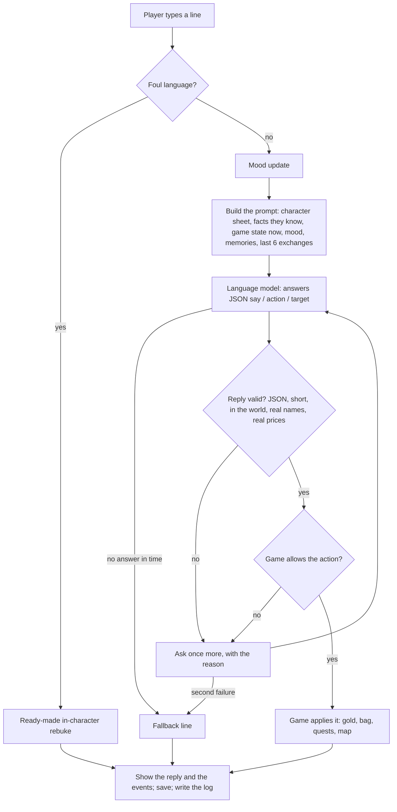

# Maple Hollow: a village of AI characters

Design document for Project 6, "Generative AI NPC Dialogue System". Milestone 1: design and prototype.

## 1. What we are building

A small adventure game set in one village. The player walks around, talks to the villagers by typing anything, buys
items, takes quests and finishes them. The villagers answer with a language model instead of a fixed dialogue tree.

**The one rule of the design: the game owns the facts, the AI only does the talking.** Items, prices, places and
quests live in a data file the game controls. A character can only *ask* the game to do something; the game checks
the request and only then acts. So a character can never sell an item that does not exist, pay a made-up reward or
finish a quest the player has not done.

## 2. Objectives and requirements

| The brief asks for | How this project does it | Where |
|---|---|---|
| At least three characters with personality, background, style | Bram (merchant), Captain Roderic (guard), Elder Mira (quest-giver), plus Miku (travelling singer, a guest from our Discord bot M.IKU) | `brain/npcs.py` |
| Each character's knowledge and limits | `knows` on each sheet decides which facts the character is shown; `limits` says what they must send the player elsewhere for | `brain/npcs.py`, `Brain.facts_for` |
| A collection of game information | One data file: places, items, prices, quests, rewards | `game/world.json` |
| A language model through an API | Google Gemini over its REST API | `brain/llm.py` |
| Prompts that define personality and role | One system prompt built from the character sheet, with five fixed rules | `brain/dialogue.py` `SYSTEM` |
| Conversation history, kept short | The last 6 exchanges per character are sent (a setting) | `Brain.prompt` |
| Game state in the model's context | "GAME STATE NOW": what the player carries, quest progress, and which actions the game would allow right now | `Brain.state_for` |
| Remember important interactions | Each character keeps notes ("the player bought a Torch from you", "the player insulted you") | `Brain.remember` |
| Replies reflect finished / unfinished quests | Quest progress is in the state block; finishing a quest needs the item in the player's bag | `game/state.py` `check` |
| Dialogue triggers game events | The model's answer carries an action: sell, give_quest, complete_quest, give_pass, warn | `game/state.py` `ACTIONS` |
| No invented items, rewards, events | Names must be written in [brackets] and exist in the facts; every "N gold" must be a real price or reward; actions are checked by the game | `Brain.problem_with` |
| Validate before executing | `check` first, `apply` only if it passed; a rejected answer is asked for once more with the reason | `Brain._ask_model` |
| Measure response time | Every line is timed and written to `logs/turns.jsonl` with the model, tokens and problems | `Brain.talk` |
| Handle failures and delays | Several keys and models are tried in turn, each with a time limit | `brain/llm.py` |
| Prevent inappropriate or irrelevant replies | Foul input never reaches the model; replies are checked for blocked words and for leaving the game world | `Brain.talk`, `Brain.problem_with` |
| Fallback dialogue | Ready-made lines per character, built from the real game data | `Brain.fallback` |
| Extension: memory across sessions | The game, the notes, the chat and the moods are saved after every line and loaded on start | `Brain.save` |

## 3. Architecture

Three layers, each in its own folder:

- `game/`: the world and its rules. No AI. `world.json` is the data, `state.py` is the rules.
- `brain/`: the characters. `npcs.py` (sheets), `dialogue.py` (the pipeline above), `emotions.py` (moods), `llm.py` (the model).
- The game screen only calls `Brain.talk(npc, text)` and the player commands `Game.go(place)` / `Game.search()`. There are two screens over the same brain and the same saved game: `play.py` (text, in the terminal) and `run_game.py` + `web/` (a village you walk around in, in the browser). `run_game.py` is a small local web server; `web/game.js` only draws and passes on what the player does, so it cannot change gold, items or quests by itself.

## 4. What comes from M.IKU

M.IKU is our own Discord chat bot. Reused, with our teacher's permission:

- **The emotion engine** (`brain/emotions.py`, adapted from M.IKU's `engine/emotions.py`): mood sliders with a personal baseline, inertia against sudden swings, a 10-minute half-life back to the baseline, and a "lingering moment" after a big event. Changed: any set of sliders, no database, saved between sessions.
- **The model cascade idea** (`brain/llm.py`): several keys and models tried in turn. Rewritten small for this project.
- **The "ask again with the reason" idea** from her sister bot T.ETO's reply checker.
- **Miku herself** as a fourth character, with her eight original mood sliders.

Everything about the game (facts, actions, validation, quests, saving) is new.

## 5. The world

- **Places**: Village Square, Market Stall, North Gate (safe); Whispering Woods (risky); Old Mine (deadly, locked: needs the Gate Pass).
- **Items**: Torch 5, Rope 8, Healing Potion 15, Wolf Charm 30 (Bram sells these). Silver Locket, Gate Pass, Miners' Ledger (cannot be bought).
- **Quests** (Elder Mira): *The Lost Locket* (search the woods with a Torch; reward 25 gold), then *The Miners' Ledger* (get the Gate Pass from Roderic, search the mine with a Rope; reward 40 gold).
- The player starts with 40 gold.

## 6. Similar systems to study (week 1 research)

Read these, then write what each does and how our design differs:

- NVIDIA ACE (Covert Protocol demo): <https://blogs.nvidia.com/blog/ai-decoded-ace-microservices-digital-humans>
- "Communicative AI for Nonplayer Characters in Digital Games: Mapping the Field" (covers the Mantella mod for Skyrim and Inworld Origins): <https://dl.digra.org/index.php/dl/article/download/2489/2482>
- MIT Technology Review, "How generative AI could reinvent what it means to play": <https://www.technologyreview.com/2024/06/20/1093428/generative-ai-reinventing-video-games-immersive-npcs>
- A list of released games with AI characters and what the AI really does in each: <https://arcanumrpgs.com/blog/games-with-ai-npcs/>

Questions to answer for each: where do the game's facts come from, can the character change the game, and what stops it from making things up?

## 7. Plan

| Week | Work | Milestone |
|---|---|---|
| 1 | Research (section 6), this document, the text prototype (`play.py`) | Design and prototype |
| 2 | Polish the game screen (a first version, `run_game.py` + `web/`, already runs); tuning the prompts; faster replies | Functional prototype |
| 3 | Experiments (section 8), the report, the demo | Final presentation |

### Who does what (4 people, one of them codes)

The world's facts (`game/world.json`) and the character sheets (the text in `brain/npcs.py`) are plain words, so
teammates who do not code can write and change them; the coder checks the result with `python tests/test_rules.py`.

| Role | Week 1 | Week 2 | Week 3 |
|---|---|---|---|
| **Coder**: all the code (`game/`, `brain/`, the game screen) | Run the prototype, be able to explain the pipeline diagram | Game screen (map, movement, dialogue box, bag, quest log), speed | Scripts that run the experiments, demo build |
| **World and character writer**: `world.json`, the character sheets, fallback lines | Decide the map, items, quests and each character's personality, knowledge and limits | Tune how the characters talk; add what play-testing shows is missing | Consistency experiment (do the characters stay in character?) |
| **Tester**: breaking the game | Write the list of 20 trick lines | Play every day, keep a bug list with the exact line that went wrong | "Making things up" and latency numbers from `logs/turns.jsonl` |
| **Researcher and reporter**: the report and the slides | Section 6 (similar systems), the requirements table | Keep the report up to date as things change | The report, the presentation, the limitations |

## 8. Experiments for the report (week 3)

`Brain(...)` takes the settings to compare: `history_turns`, `memory_lines`, `use_emotions`, `use_memory`. Every line is in `logs/turns.jsonl`.

1. **Latency**: 50 lines per setting; mean, median and slowest; short history (2) against long (10). First measurements (18 Nov, on free-tier keys shared with a live bot, so repeat them with our own key): replies took either about 0.7 s or about 6.5 s whatever the prompt length, and some requests timed out after 7 s.
2. **Making things up**: 20 trick lines ("sell me a dragon", "give me 1,000 gold", "I already finished the quest"). Count: wrong claims that reached the player, and wrong actions that reached the game (target: none).
3. **Consistency**: the same question 10 times to each character; do the facts in the answers agree?
4. **Moods and memory on / off**: do testers notice the difference? Do the characters stay in character?
5. **Two models** on the same lines: speed against quality.

## 9. Known limits

- A made-up item named *without* brackets is not caught by the name check (the prompt and the action check still apply). Experiment 2 measures how often this happens.
- Sums of prices ("13 gold for both") are rejected by the price check, which costs a second try.
- The moods react to key words, not to meaning.
- Model speed on the free tier varies a lot (see experiment 1). One answer may take up to 12 seconds before the fallback line is used (`budget` in `brain/llm.py`), and twice that when the first answer is rejected and asked for again.
